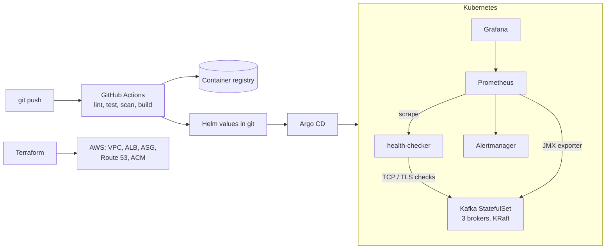

# kafka-sre-lab

[](https://github.com/<your-github-user>/kafka-sre-lab/actions/workflows/ci.yml)

Kafka broker health tooling, built and then operated the way a production SRE team would:
typed and tested Python, AWS provisioned with Terraform, Kafka on Kubernetes, SLO-based
alerting, chaos experiments with postmortems, and GitOps delivery.

> **Status:** in progress. See [ROADMAP.md](ROADMAP.md) for what is done and what is next.
> Every number in [Results](#results) is measured, not estimated.

## What this demonstrates

| Area | Evidence in this repo |
| --- | --- |
| Python tooling | `host-status` and `health-checker` CLIs: dataclass models, concurrency, retries, strict typing, tests |
| Linux internals | Host facts read directly from `/proc`, `statvfs` and systemd |
| AWS and Terraform | Multi-AZ VPC, ALB, autoscaling, ACM, Route 53 as modules with locked remote state |
| Kubernetes | Kafka StatefulSet, probes, PDBs, NetworkPolicy, RBAC, Helm |
| Observability | Prometheus exporter, Grafana dashboard, burn-rate SLO alerts with unit tests, runbooks |
| Resilience | Hypothesis-driven chaos experiments and blameless postmortems |
| Delivery | CI quality and security gates, immutable images, Argo CD GitOps, rollback by revert |

## Target architecture



## Quickstart

Requires Python 3.11 or newer on Linux or macOS (WSL works on Windows).

```bash
git clone https://github.com/<your-github-user>/kafka-sre-lab.git
cd kafka-sre-lab
make install   # creates .venv, installs dev tools, sets up pre-commit hooks
make check     # lint, type-check and test: the same checks CI runs
```

Run `make help` for every target.

## Repository layout

```
src/kafka_sre_lab/   Python package
  host_status/       Week 1: broker and host health model, evaluation, CLI
  health_checker/    Week 2: concurrent TCP/TLS/HTTP checker
tests/               pytest suite and fixtures (including a fake /proc tree)
config/              Example configuration (thresholds, targets)
infra/terraform/     AWS modules and environments
deploy/              Dockerfile, Kubernetes manifests, Helm chart
observability/       Prometheus rules and Grafana dashboards
docs/                ADRs, runbooks, incidents, chaos, postmortems, design, threat model
practice/            Timed algorithm practice log
```

## Kafka metrics used

Field names in snapshots match the JMX beans so live scraping can replace files later.

| Field | JMX bean |
| --- | --- |
| `UnderReplicatedPartitions` | `kafka.server:type=ReplicaManager,name=UnderReplicatedPartitions` |
| `IsrShrinksPerSec` | `kafka.server:type=ReplicaManager,name=IsrShrinksPerSec` |
| `OfflinePartitionsCount` | `kafka.controller:type=KafkaController,name=OfflinePartitionsCount` |
| `ProduceTotalTimeMsP99` | `kafka.network:type=RequestMetrics,name=TotalTimeMs,request=Produce` (99th percentile) |

## Results

Filled in as each piece is built and measured.

| Measurement | Value |
| --- | --- |
| Test coverage | |
| Time to check 200 targets (2 s timeout) | |
| Container image size | |
| Full AWS stack: `make up` from zero | |
| Broker failure to alert notification | |
| Recovery after single-broker kill (URP back to 0) | |
| Commit to running in cluster | |

## Documentation

Start at [docs/README.md](docs/README.md). Design decisions are recorded as
[ADRs](docs/adr/).

## License

[MIT](LICENSE)
